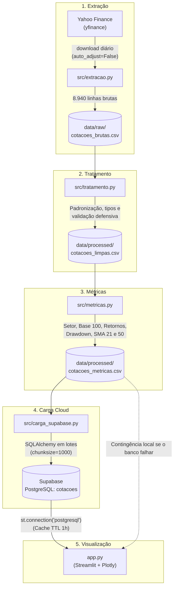
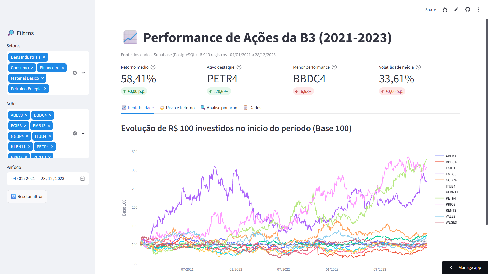
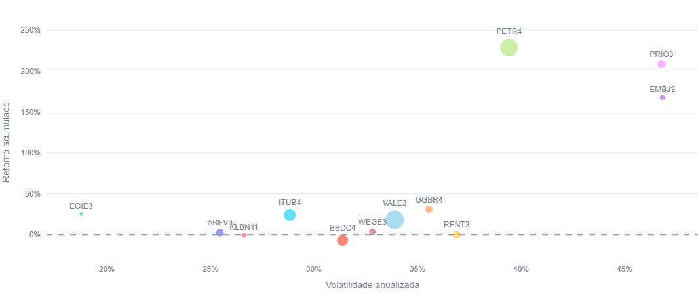
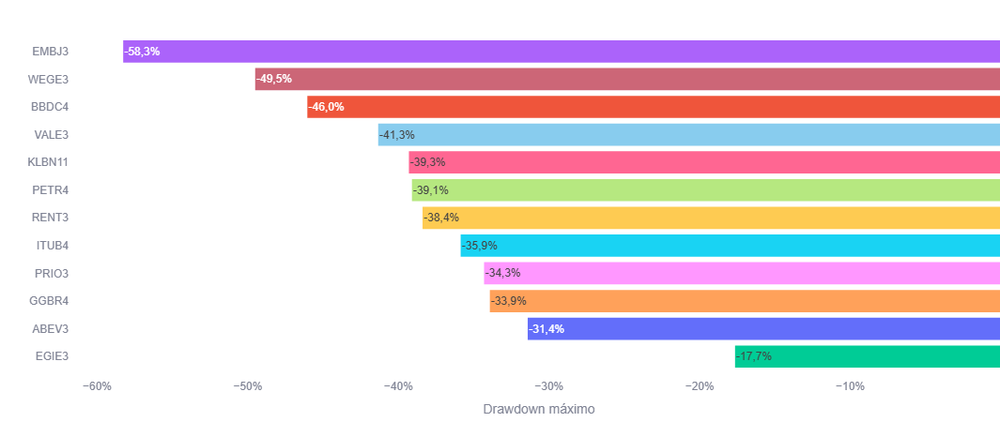
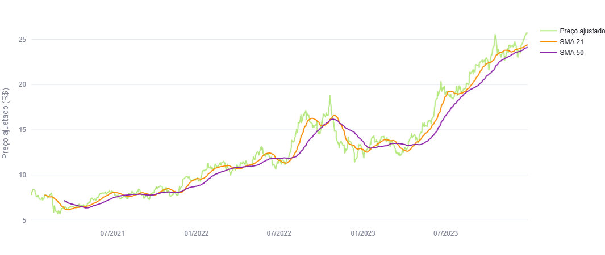
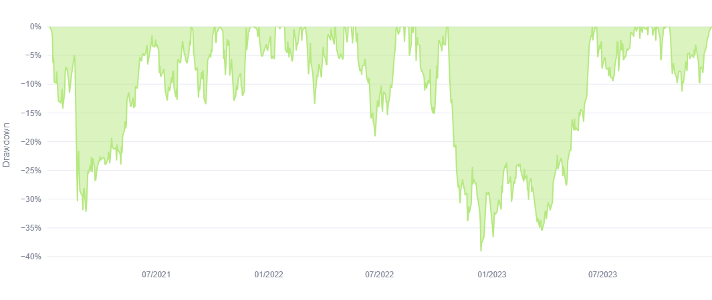
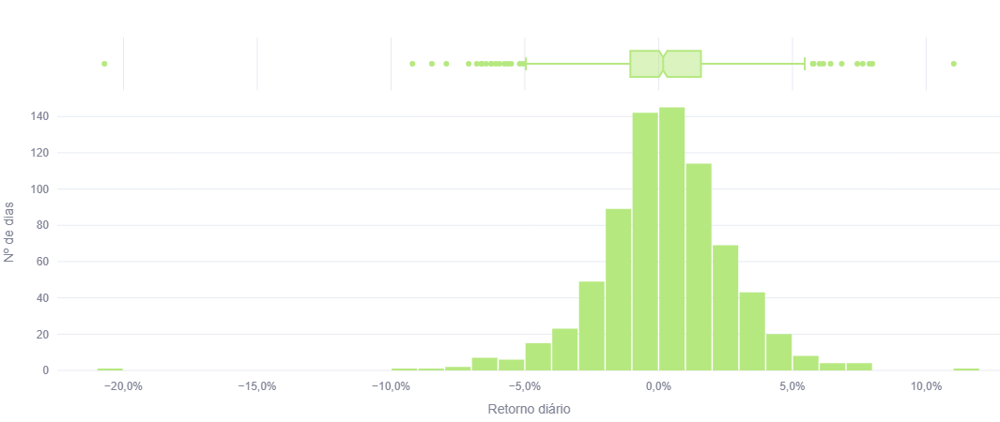
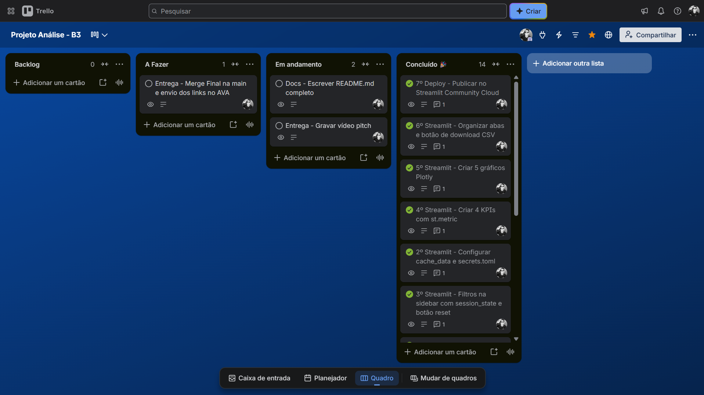

# 📈 Análise de Performance de Ações da B3 (2021–2023)


**Linha temática:** Linha 2 — Performance de Mercado de Ações (B3)

Neste projeto, analisei a rentabilidade e o risco de 12 ações da B3 entre 2021 e 2023. Construí um pipeline de dados com extração no `yfinance`, tratamento e cálculo de métricas em Python, carga no Supabase (PostgreSQL) e visualização em um dashboard interativo no Streamlit.

---

## 1. Contexto e Perguntas de Negócio

Analisei o comportamento histórico de 12 ações negociadas na B3 ao longo do triênio 2021–2023 para responder a cinco perguntas principais:

1. Qual a rentabilidade comparativa (Base 100) de cada ativo de 2021 a 2023?
2. Quais ativos tiveram a melhor relação retorno × risco (Sharpe empírico)?
3. Como se distribuem os retornos diários (dispersão, assimetria e caudas)?
4. Qual o drawdown máximo de cada ativo e qual foi o mais resiliente?
5. Como os preços se comportaram frente às médias móveis SMA 21 e SMA 50?

---

## 2. Fonte de Dados

- **Fonte:** Yahoo Finance via biblioteca [`yfinance`](https://github.com/ranaroussi/yfinance) (dados públicos, sem dados pessoais).
- **Período:** 04/01/2021 a 28/12/2023, cotação diária (745 pregões por ativo, totalizando 8.940 linhas).
- **Ativos analisados (12 empresas em 5 setores):**
  - **Bens Industriais:** `WEGE3` e `EMBJ3`
  - **Consumo:** `ABEV3` e `RENT3`
  - **Financeiro:** `BBDC4` e `ITUB4`
  - **Materiais Básicos:** `GGBR4`, `KLBN11` e `VALE3`
  - **Petróleo e Energia:** `EGIE3`, `PETR4` e `PRIO3`
- **Observação sobre o ticker da Embraer:** a `EMBR3` do enunciado passou a negociar como **`EMBJ3`** na B3 desde 03/11/2025; baixei o histórico com o código atualizado.

---

## 3. Pipeline de Dados

Para estruturar o projeto, dividi o trabalho em etapas. Primeiro investiguei e validei cada passo em notebooks (`notebooks/`), e depois consolidei o código em scripts (`src/`).



- **Extração (`src/extracao.py`):** baixei 8.940 linhas (12 ativos × 745 pregões), mantendo o preço ajustado por proventos (`Adj Close`).
- **Tratamento (`src/tratamento.py`):** renomeei as colunas para português, converti a data para `datetime` e arredondei os preços para 2 casas. Não encontrei nulos, duplicados ou preços inválidos; mantive essas verificações de forma defensiva para futuras extrações. Escolhi manter 3 registros pontuais com volume zero porque tinham preços ajustados válidos e não impactaram a análise (ver Limitações).
- **Métricas (`src/metricas.py`):** adicionei setor, volume financeiro, retorno diário, Base 100, retorno acumulado, drawdown e médias móveis (SMA 21 e SMA 50), calculados por ativo em ordem cronológica.
- **Carga (`src/carga_supabase.py`):** enviei a base tratada com métricas para a tabela `cotacoes` no PostgreSQL do Supabase, lendo as credenciais de `.streamlit/secrets.toml`.

---

## 4. Dicionário de Dados (`cotacoes_metricas.csv` / Supabase)

| Coluna | Tipo no Banco | Descrição / Cálculo |
|---|---|---|
| `data` | `timestamp` | Data do pregão |
| `nome_acao` | `text` | Código do ativo na B3 |
| `setor` | `text` | Setor econômico (classificação da B3 simplificada) |
| `abertura`, `maxima`, `minima`, `fechamento` | `double precision` | Preços do dia em R$ (2 casas decimais) |
| `fechamento_ajustado` | `double precision` | Fechamento ajustado por dividendos e desdobramentos |
| `volume` | `bigint` | Quantidade de ações negociadas no pregão |
| `volume_financeiro` | `double precision` | `volume × fechamento` (em R$, aproximado) |
| `retorno_diario` | `double precision` | Variação % do preço ajustado frente ao dia anterior |
| `base_100` | `double precision` | Preço ajustado ÷ primeiro preço da ação × 100 |
| `retorno_acumulado` | `double precision` | `(base_100 / 100) − 1` |
| `drawdown` | `double precision` | Queda % em relação ao maior preço atingido até a data |
| `sma_21`, `sma_50` | `double precision` | Médias móveis simples de 21 e 50 pregões |

### Como Interpretar as Métricas

- **Retorno diário:** variação percentual de um dia para o outro; mostra os ganhos e perdas diários e serve de base para a volatilidade.
- **Base 100:** iguala todas as ações em 100 no início para compará-las na mesma escala; se estiver em 150, significa ganho de 50%.
- **Retorno acumulado:** percentual total ganho ou perdido desde o primeiro dia do período até a data.
- **Drawdown:** mede a queda atual em relação ao maior preço já atingido pela ação. O drawdown máximo indica a pior perda suportada a partir de um pico.
- **SMA 21 e SMA 50:** médias dos preços dos últimos 21 e 50 pregões. Preço acima das médias costuma indicar alta; abaixo, baixa.
- **Volatilidade anualizada:** mede a oscilação dos retornos diários no ano (desvio padrão × $\sqrt{252}$).
- **Sharpe empírico:** retorno acumulado dividido pela volatilidade. Mostra quanto retorno o ativo entregou para cada unidade de oscilação.

---

## 5. Tecnologias

- **pandas/numpy:** padrão de mercado para tratar tabelas e séries temporais.
- **yfinance:** histórico diário gratuito da B3, já com preço ajustado por proventos.
- **Supabase (PostgreSQL):** banco na nuvem com plano gratuito e conexão padrão via SQLAlchemy.
- **Streamlit:** publica um app interativo só com Python, sem front-end separado.
- **Plotly:** gráficos interativos (zoom, hover, legenda clicável).
- **Git/GitHub e Trello:** versionamento com GitFlow e organização das tarefas em Kanban.

---

## 6. Principais Resultados

Tabela com as métricas consolidadas dos 12 ativos ao fim do período (28/12/2023), ordenadas pelo Sharpe empírico:

| Ativo | Setor | Retorno acumulado | Volatilidade anual | Drawdown máx. | Sharpe empírico |
|---|---|---:|---:|---:|---:|
| PETR4 | Petróleo e Energia | 228,69% | 39,42% | −39,10% | 5,80 |
| PRIO3 | Petróleo e Energia | 208,32% | 46,78% | −34,32% | 4,45 |
| EMBJ3 | Bens Industriais | 167,50% | 46,82% | −58,27% | 3,58 |
| EGIE3 | Petróleo e Energia | 25,35% | 18,76% | −17,65% | 1,35 |
| GGBR4 | Materiais Básicos | 30,79% | 35,56% | −33,93% | 0,87 |
| ITUB4 | Financeiro | 24,02% | 28,83% | −35,87% | 0,83 |
| VALE3 | Materiais Básicos | 18,11% | 33,90% | −41,34% | 0,53 |
| WEGE3 | Bens Industriais | 3,51% | 32,83% | −49,51% | 0,11 |
| ABEV3 | Consumo | 2,57% | 25,46% | −31,42% | 0,10 |
| RENT3 | Consumo | −0,25% | 36,89% | −38,40% | −0,01 |
| KLBN11 | Materiais Básicos | −0,80% | 26,62% | −39,30% | −0,03 |
| BBDC4 | Financeiro | −6,93% | 31,38% | −46,05% | −0,22 |

### Principais Descobertas

- **Petróleo e Energia liderou em retorno e Sharpe:** PETR4 teve o maior retorno acumulado (+228,69%) e maior Sharpe (5,80), seguida por PRIO3 (+208,32% e Sharpe 4,45).
- **EGIE3 teve a menor oscilação da carteira:** registrou a menor volatilidade anual (18,76%) e o menor drawdown máximo (−17,65%), com retorno de +25,35%.
- **EMBJ3 teve alto retorno com forte queda no caminho:** subiu +167,50% no período, mas sofreu o pior drawdown de todos os ativos (−58,27%).
- **Três ativos fecharam no negativo:** RENT3 (−0,25%), KLBN11 (−0,80%) e BBDC4 (−6,93%), sendo que no setor financeiro ITUB4 (+24,02%) superou BBDC4 em quase 31 pontos percentuais.

---

## 7. Limitações

- O painel descreve o comportamento dos preços; **correlação não implica causalidade**.
- **Sharpe empírico simplificado:** usa o retorno acumulado de 3 anos e não desconta a taxa livre de risco (CDI/Selic). Serve apenas para comparar os 12 ativos entre si.
- **Volume zero:** 3 registros (0,03% da base: WEGE3 e PRIO3 em 26/09/2022; BBDC4 em 02/06/2023) vieram com volume zero e preços idênticos na fonte. Mantive na base porque tinham preço ajustado válido.
- **Preço ajustado e volume financeiro:** seguem a metodologia do Yahoo Finance e uma aproximação por `volume × fechamento`, respectivamente.
- **Amostra restrita:** resultados limitados a 12 ações e 3 anos (2021 a 2023).
- **⚠️ Aviso legal:** *Este é um estudo acadêmico de análise de dados. As análises e métricas apresentadas não constituem recomendação de investimento. Rentabilidade passada não garante rentabilidade futura.*

### Próximos Passos

- [ ] Incluir o Ibovespa e o CDI diário como referências de comparação para calcular o Sharpe tradicional.
- [ ] Automatizar a atualização diária dos dados.
- [ ] Adicionar outros indicadores técnicos (como IFR/RSI e Bandas de Bollinger).

---

## 8. Aplicação Profissional

### Como o painel apoia a tomada de decisão

Pensei o painel para que um investidor, gestor ou diretor financeiro consiga responder rapidamente perguntas práticas antes de decidir:

- **Comparar retorno e risco antes de montar uma carteira:** no gráfico de Risco × Retorno, dá para ver de imediato quais ações renderam mais e quanto oscilaram para isso, evitando escolher um ativo só pelo retorno.
- **Avaliar um setor contra o conjunto:** ao filtrar um setor na barra lateral, os deltas dos KPIs mostram se ele ficou acima ou abaixo da média das 12 ações no mesmo período.
- **Identificar as ações mais resilientes:** o ranking de drawdown máximo mostra quais ativos caíram menos a partir de um pico, o que é útil para quem tem perfil mais conservador.
- **Analisar janelas específicas:** ao mudar o período, o painel recalcula a Base 100 e as quedas a partir da nova data, permitindo comparar momentos diferentes do mercado.
- **Levar os dados para outras análises:** o botão de download exporta os dados filtrados em CSV, pronto para abrir no Excel.

### O que pratiquei como analista

Neste projeto, pratiquei atividades que fazem parte do dia a dia de um analista de dados:

- **Pipeline de dados (ETL):** extraí dados de uma fonte pública, tratei e validei a qualidade, calculei métricas e carreguei o resultado em um banco de dados na nuvem, separando cada etapa em scripts reaproveitáveis.
- **Análise de risco e retorno:** aprendi a não olhar só para quanto um ativo rendeu, mas também para quanto ele oscilou e quanto caiu no pior momento.
- **Comunicação dos resultados:** transformei os dados em um dashboard interativo, para que qualquer pessoa consiga explorar a análise sem precisar abrir o código.
- **Organização do trabalho:** usei Git com GitFlow e um quadro Kanban no Trello para controlar as tarefas, como acontece em equipes de dados.

---

## 9. Data App

Desenvolvi o dashboard com Streamlit e Plotly:

🔗 **Link do App:** [Aplicativo Streamlit](https://projeto-luiz-fernando-jesus-b3-m2.streamlit.app/)

- **Filtros na barra lateral:** seleção por setor, por ação (atualizada conforme os setores) e por intervalo de datas. Ao mudar o período, o app recalcula a Base 100, o retorno e o drawdown a partir da nova data inicial. Inclui botão para resetar filtros.
- **KPIs de destaque:** retorno médio da seleção, ativo de maior retorno, ativo de menor retorno e volatilidade média, com a diferença em relação à média das 12 ações.
- **Aba 1 (📈 Rentabilidade):** gráfico de linhas com a evolução da Base 100 de cada ativo e linha de referência em 100.



- **Aba 2 (⚖️ Risco e Retorno):** gráfico de dispersão (retorno × volatilidade, com tamanho pelo volume financeiro) e gráfico de barras com o drawdown máximo.




- **Aba 3 (🔍 Análise por ação):** preço versus médias móveis SMA 21 e SMA 50, área com a evolução do drawdown, histograma dos retornos diários e tabela com estatísticas do ativo escolhido.





- **Aba 4 (📋 Dados):** tabela completa dos dados filtrados e botão para baixar em CSV formatado no padrão brasileiro (delimitador `;` e decimal `,`).
- **Contingência:** o app busca os dados no Supabase; se o banco estiver fora do ar ou sem o arquivo de credenciais, carrega o CSV local automaticamente.

---

## 10. Como Executar

Os dados tratados acompanham o repositório em `data/`. Para rodar localmente no Windows com PowerShell:

```powershell
# 1. Clonar o repositório
git clone https://github.com/LuizPk13/M2_Projeto_Final_Analise_B3.git
cd M2_Projeto_Final_Analise_B3

# 2. Criar e ativar o ambiente virtual
python -m venv .venv
.venv\Scripts\Activate.ps1

# 3. Instalar as dependências
pip install -r requirements.txt

# 4. Credenciais do Supabase (opcional)
# Copie o modelo e preencha com sua URL de conexão se quiser usar o banco remoto:
Copy-Item .streamlit\secrets.toml.example .streamlit\secrets.toml
# Sem o secrets.toml, o app usa o CSV local de contingência.

# 5. Executar o pipeline ETL (opcional, bases já inclusas em data/)
python src/extracao.py
python src/tratamento.py
python src/metricas.py
python src/carga_supabase.py

# 6. Rodar o dashboard
streamlit run app.py
```

---

## 11. Estrutura de Pastas

```text
M2_Projeto_Final_Analise_B3/
├── .streamlit/
│   ├── config.toml                # Tema visual do Streamlit
│   ├── secrets.toml.example       # Modelo de credenciais Supabase
│   └── secrets.toml               # Credenciais locais (ignorado Git)
├── assets/                        # Prints usados no README
├── data/
│   ├── raw/
│   │   └── cotacoes_brutas.csv    # Cotações brutas do yfinance
│   └── processed/
│       ├── cotacoes_limpas.csv    # Dados tratados e padronizados
│       └── cotacoes_metricas.csv  # Base com métricas calculadas
├── notebooks/
│   ├── 01_tratamento.ipynb        # Exploração e limpeza inicial
│   └── 02_metricas.ipynb          # Validação matemática das métricas
├── src/
│   ├── extracao.py                # Extração diária via yfinance
│   ├── tratamento.py              # Limpeza e padronização defensiva
│   ├── metricas.py                # Cálculo das métricas financeiras
│   └── carga_supabase.py          # Carga no banco PostgreSQL
├── app.py                         # Painel interativo no Streamlit
├── requirements.txt               # Relação de dependências instaladas
└── README.md                      # Documentação completa do projeto
```

---

## 12. Gestão Ágil e Links

- 📋 **Trello:** [Quadro do Projeto — Análise B3](https://trello.com/b/nUl2gxb3/projeto-analise-b3)
- 🚀 **App:** [Aplicativo Streamlit](https://projeto-luiz-fernando-jesus-b3-m2.streamlit.app/)
- 🎥 **Vídeo:** [Link do video](https://drive.google.com/file/d/1UvxAFYQLe3ggXYv6LBPVRgbs4G4fF4W5/view?usp=sharing)



Usei GitFlow para versionamento: branch `main` para código estável, `develop` para desenvolvimento e branches `feature/*` para cada etapa do pipeline, integradas via Pull Request.

---

## 13. Autoria e Referências

**Luiz Fernando de Jesus Silva Homem** · [Meu GitHub](https://github.com/LuizPk13) · Projeto Final — Módulo 2: Visualização de Dados e BI — SESISENAI/SC · LAB365 · Prof. Savio Ricardo Garcia

- [pandas](https://pandas.pydata.org/docs/) · [yfinance](https://github.com/ranaroussi/yfinance) · [Streamlit](https://docs.streamlit.io/) · [Plotly](https://plotly.com/python/plotly-express/) · [Supabase](https://supabase.com/docs)
- [Mudança de ticker da Embraer para EMBJ3 — Análise de Ações](https://www.analisedeacoes.com/noticias/embraer-embr3-mudara-de-ticker-na-b3-e-na-nyse-a-partir-de-3-de-novembro/)
- Assistentes de IA utilizados: Claude (Anthropic) no apoio técnico inicial e revisão de código; Gemini (Google Antigravity) no apoio à estruturação e documentação final.
